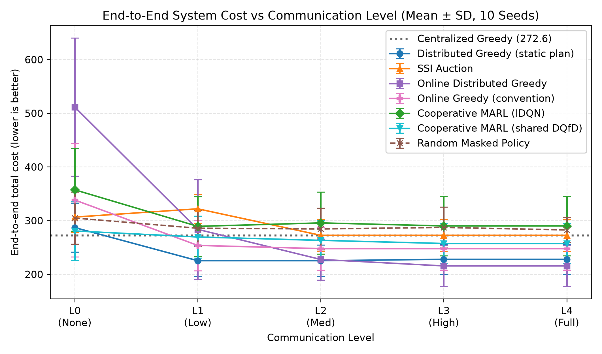
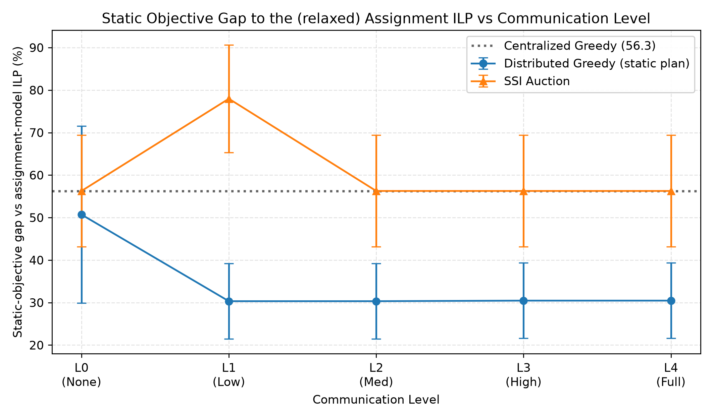
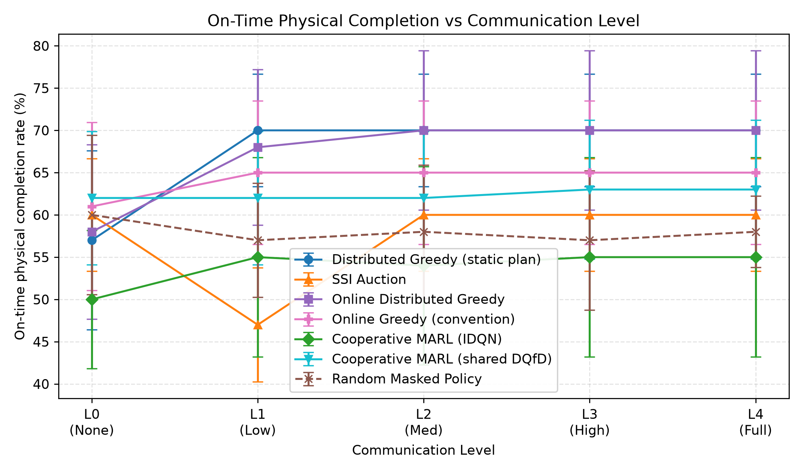
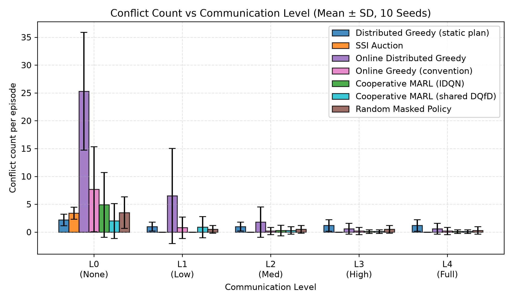
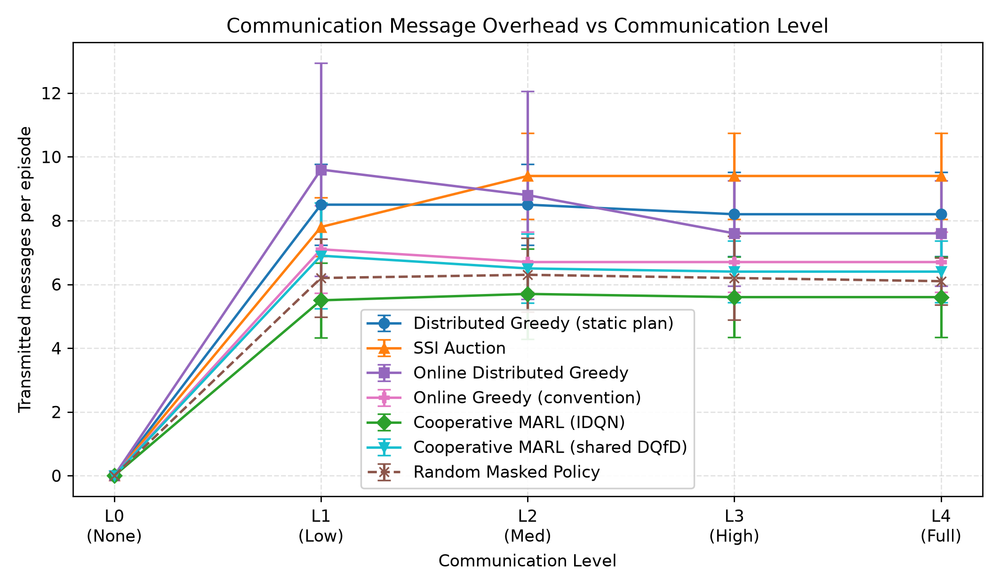
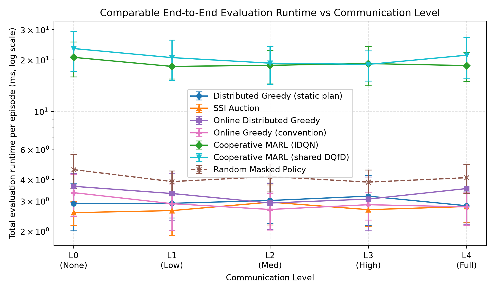
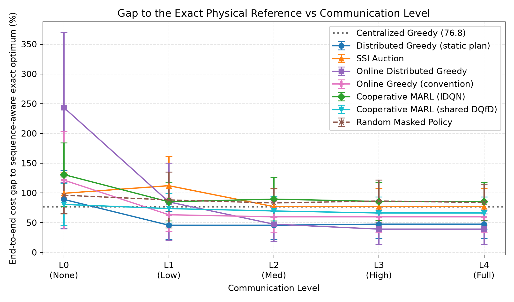

# Multi-Robot Task Allocation Under Limited Communication (MRTA-LC)

**Course Project – Group 45**  
**Indian Institute of Technology Gandhinagar**

This project investigates how limited inter-robot communication affects task allocation, coordination conflicts, task completion, and execution cost in a simulated warehouse environment.

Three heterogeneous robots allocate and execute ten pickup-and-delivery tasks while considering capabilities, task capacities, deadlines, battery constraints, and communication limitations.

The project implements three primary approaches from the original proposal—Centralized Greedy, Distributed Greedy, and Cooperative Multi-Agent Reinforcement Learning (MARL)—along with Exact Integer Linear Programming (ILP) and an SSI-style auction baseline. Additional methods are evaluated as supplementary extensions.

---

## 1. Project Objectives

The main objective is to study the relationship between communication availability and multi-robot coordination performance.

The project investigates:

How communication frequency affects task allocation and execution cost.
Whether communication reduces duplicate task claims and coordination conflicts.
How cooperative MARL performs under sparse communication.
How heuristic and learning-based methods compare with optimization-based references.
How static assignment quality differs from actual physical task completion.
## 2. Problem Configuration

The warehouse environment consists of:

| Parameter | Configuration |
|---|---|
| Number of robots | 3 |
| Number of tasks | 10 |
| Warehouse | 10 × 10 grid |
| Robot capabilities | A, B, and A+B |
| Robot task capacity | 3 tasks per robot |
| Initial battery | 100 |
| Task handling duration | 2–4 steps |
| Task deadlines | 20–45 steps |
| Evaluation seeds | 1–10 |
| Maximum episode length | 60 steps |

Tasks are generated as a static batch at the beginning of each episode. Robots must select and execute tasks while respecting capability, capacity, deadline, and battery constraints.

## 3. Communication Model

Five communication levels are evaluated by varying the synchronization period and message budget.

| Level | Synchronization period (k) | Message budget (B) | Description |
|---|---:|---:|---|
| L0 | Never | 0 | No communication |
| L1 | 10 steps | 6 | Low communication |
| L2 | 5 steps | 15 | Medium communication |
| L3 | 1 step | 100 | High communication |
| L4 | Immediate | Unlimited | Immediate message delivery |

L4 represents immediate delivery of explicitly transmitted messages. It does not provide automatic access to global robot or task states.

## 4. Implemented Algorithms

### 4.1 Centralized Greedy

A central controller observes the complete robot and task states. Tasks are processed in deterministic task-ID order. For each task, the controller identifies feasible robots based on capability, capacity, route feasibility, and battery constraints.

The task is assigned to the feasible robot with the lowest estimated assignment cost. If no robot is feasible, it remains unassigned.

### 4.2 Distributed Greedy

Each robot independently maintains local information about task claims and selects feasible tasks using its estimated assignment cost.

Robots communicate through CLAIM messages subject to synchronization intervals and message budgets. When multiple robots claim the same task, the lower-cost claim is retained, with robot ID used as a deterministic tie-break.

The implementation evaluates both static allocation and online Distributed Greedy. Static allocation constructs plans before physical execution, whereas online decisions are made throughout the execution episode.

### 4.3 Cooperative MARL – Independent DQN (IDQN)

Three independent Deep Q-Network agents make decentralized task-selection decisions.

Each robot receives an 87-dimensional observation containing local state, capabilities, battery information, task features, and teammate information received through communication.

The action space consists of ten task-selection actions and one WAIT action. Infeasible actions are removed through action masking.

The network architecture is:

87 → 64 → 64 → 11

Training uses replay memory, target networks, and epsilon-greedy exploration. Communication availability is controlled externally; the agents do not learn a communication protocol.

### 4.4 Exact ILP Assignment Baseline

The assignment problem is formulated as an Integer Linear Program and solved using scipy.optimize.milp with the HiGHS solver.

The model considers task ownership, robot capabilities, task capacity, individual deadline feasibility, and unassigned-task penalties.

This is an offline static assignment reference, not a complete sequential route scheduler.

### 4.5 SSI-Style Sequential Auction

Tasks are processed sequentially. Eligible robots calculate bids and transmit them through the communication channel to a logical auctioneer. The lowest successfully delivered bid wins.

At L0, no bids are delivered, so a deterministic no-communication contention fallback is used. This case is not an auctioneer-cleared auction.

## 5. Supplementary Methods

The project also evaluates the following extensions:

**Sequence-aware Exact ILP:** A set-partitioning formulation that considers feasible ordered task sequences, route-dependent deadlines, capacity, and battery feasibility.
**Online Distributed Greedy:** Applies decentralized greedy decisions during physical execution.
**No-message coordination convention:** Uses a predetermined robot-task preference rule to study coordination without explicit communication.
**Shared-parameter DQfD:** Uses a shared Q-network, robot-ID input, Double DQN updates, and a demonstration-based large-margin loss.
**Random Masked Policy:** Selects uniformly among actions permitted by the action mask and serves as a random valid-action control.
These are supplementary extensions and do not replace the three original project approaches.

## 6. Methodology and Evaluation

The experiments use ten common evaluation seeds. Each method evaluated for a given seed receives the same initial scenario.

The benchmark contains 380 method-level evaluations. Results are reported as mean and sample standard deviation across the ten evaluation seeds.

Three cost measures are distinguished:

1. **Static assignment objective:** Estimated assignment cost plus the unassigned-task penalty.
2. **Physical execution cost:** Travel distance and physical penalties for unassigned tasks, missed deadlines, and physical conflicts.
3. **End-to-end cost:** Physical execution cost plus the allocation-stage conflict penalty.

Other evaluation metrics include:

Assignment rate.
On-time task completion rate.
Conflict count.
Successfully transmitted messages.
Runtime.
Optimality gap against the appropriate optimization reference.
The assignment ILP gap and the gap to the sequence-aware physical reference measure different objectives and should not be interpreted interchangeably.

## 7. Experimental Results

The following table summarizes the mean end-to-end costs reported in the final report.

| Method | L0 | L1 | L2 | L3 | L4 |
|---|---:|---:|---:|---:|---:|
| Sequence-aware ILP | — | — | — | — | — |
| Centralized Greedy | — | — | — | — | — |
| Distributed Greedy | 287.0 | 225.3 | 225.3 | 227.9 | 227.9 |
| SSI Auction | 306.6 | 322.0 | 272.6 | 272.6 | 272.6 |
| Online Distributed Greedy | 511.6 | 283.7 | 227.6 | 215.6 | 215.6 |
| No-message convention | 338.4 | 253.8 | 247.8 | 247.8 | 247.8 |
| IDQN | 357.4 | 289.3 | 295.7 | 290.1 | 290.1 |
| Shared DQfD | 280.7 | 269.5 | 263.2 | 257.4 | 257.4 |
| Random Masked | 304.8 | 285.8 | 284.5 | 287.3 | 282.6 |

**Optimization references:**

Assignment-based Exact ILP: static objective of 194.01 ± 16.38.
Sequence-aware Exact ILP: physical reference cost of 159.50 ± 41.45, with 83% on-time completion.
The sequence-aware ILP is reported separately because it models feasible task sequences and serves as a stronger physical reference.

### 7.1 Main Observations

**Effect of communication on Distributed Greedy**

Online Distributed Greedy improves substantially as communication becomes more available. Its mean end-to-end cost decreases from 511.6 at L0 to 215.6 at L3.

Static Distributed Greedy improves from 287.0 at L0 to 225.3 at L1 and L2. Its cost increases slightly to 227.9 at L3 and L4, showing that improvement is not strictly monotonic.

**Conflict reduction**

Online Distributed Greedy reduces mean conflicts from 25.3 at L0 to 1.8 at L2, a 92.9% reduction.

Static Distributed Greedy reduces conflicts from 2.2 at L0 to 1.0 at L2, a 54.5% reduction. This does not meet the original greater-than-80% target.

**MARL performance**

The original IDQN policy does not demonstrate a meaningful advantage over the Random Masked baseline.

Shared DQfD performs better descriptively than the random control, but its results do not establish a general MARL advantage or statistical superiority without supporting paired-test evidence.

### 7.2 Hypothesis Summary

| Hypothesis | Conclusion |
|---|---|
| H1: Communication improves allocation cost from L0 to L3 | Supported for Online Distributed Greedy; static Distributed Greedy improves overall but is not strictly monotonic. |
| H2: Communication reduces Distributed Greedy conflicts by more than 80% from L0 to L2 | Supported for Online Distributed Greedy; not supported for static Distributed Greedy. |
| H3: MARL improves coordination under sparse communication | Shared DQfD shows descriptive improvements, but a general MARL advantage is not established. |

Inferential claims should be made only where the corresponding paired statistical test results are available.

## 8. Result Plots

The repository includes seven plots generated from the experimental results.

### 8.1 End-to-End Cost

### 8.2 Static Assignment Optimality Gap

### 8.3 On-Time Completion Rate

### 8.4 Conflict Count

### 8.5 Communication Overhead

### 8.6 Runtime

### 8.7 Gap to Sequence-Aware Physical Reference

## 9. Repository Structure

The following is a high-level overview. Refer to the actual repository for the complete directory structure.
text
multi_robot_task_allocation/
│
├── README.md
├── requirements.txt
├── config.py
├── run_experiments.py
│
├── src/
│   ├── env/
│   ├── communication/
│   ├── baselines/
│   ├── marl/
│   └── evaluation/
│
├── scripts/
├── models/
├── tests/
│
├── results/
│   ├── experiment_config.json
│   ├── experiment_results.csv
│   ├── aggregated_results.csv
│   ├── summary_tables.md
│   └── figures/
│
├── report/
│   ├── final_report.pdf
│   └── final_report.tex
│
└── screenshots/

Some supplementary scripts, checkpoints, and supporting analysis files may be present in the repository.

## 10. Installation and Execution

### 10.1 Clone the Repository
bash
git clone https://github.com/sidda19/multi_robot_task_allocation.git
cd multi_robot_task_allocation

### 10.2 Set Up the Python Environment

Create a virtual environment:

**Windows PowerShell:**
powershell
python -m venv .venv
.venv\Scripts\Activate.ps1

**Linux/macOS:**
bash
python3 -m venv .venv
source .venv/bin/activate

Install dependencies:
bash
python -m pip install --upgrade pip
pip install -r requirements.txt

### 10.3 Run the Experiments

From the repository root:
bash
python run_experiments.py

This runs the main experiment pipeline. Refer to the experiment configuration and script options in the repository before changing seeds or evaluation settings.

### 10.4 Run the Baseline Demonstration

If the demonstration script is included:
bash
python run_member1_member2_demo.py

### 10.5 Run the Tests
bash
python -m unittest discover -s tests -v

The final reported verification includes 34 passing tests. Test results may vary if the environment or dependencies differ.

## 11. Reproducibility and Model Checkpoints

The repository maintains the experiment configuration, raw evaluation observations, aggregated results, generated figures, source code, tests, and model checkpoints.

Important result files:

| File | Purpose |
|---|---|
| results/experiment_config.json | Experiment configuration |
| results/experiment_results.csv | Per-seed experimental observations |
| results/aggregated_results.csv | Aggregated metrics |
| results/summary_tables.md | Result summaries |
| results/figures/ | Generated experimental plots |

Model checkpoints are maintained under the repository's model directories. Training and evaluation scripts should be used with their corresponding checkpoints and metadata.

For supplementary statistical and mathematical analyses, consult the relevant scripts and outputs included in the repository.

## 12. Team Contributions

| Member | Assigned responsibilities | Fulfilment |
|---|---|---|
| Sidda Divya | MARL environment, observation/action/reward design, IDQN training and evaluation, integrated experimental analysis | Completed |
| Manemoni Sumanjali | Mathematical formulation, task ownership and resource constraints, Exact ILP, Centralized Greedy | Completed |
| Killada Eswara Valli | Communication model, Distributed Greedy, SSI Auction, information sharing, conflict handling | Completed |
| All members | Experimental design, result analysis, report preparation, presentation | Shared contribution |

Individual responsibilities and fulfilment are described in the final academic report.

## 13. Limitations and Future Work

The current implementation has the following limitations:

The environment uses static batch task arrivals rather than dynamic task streams.
The warehouse contains only three robots and ten tasks.
Movement uses Manhattan grid steps and does not model continuous robot kinematics or full collision-free motion planning.
The assignment ILP does not optimize complete multi-task route sequences.
The sequence-aware ILP is more computationally demanding and is intended for the small experimental setting.
MARL evaluation uses trained checkpoints and ten evaluation seeds; broader generalization and convergence are not established.
The Shared DQfD method uses demonstrations from a hand-designed coordination rule.
Future work includes larger task sets, dynamic task arrivals, more extensive MARL training, and learned communication strategies.

## 14. Final Academic Report

The final academic report, including the problem formulation, methodology, experimental setup, results, discussion, team contributions, limitations, and references, is available in the report/ directory.

**Repository:**  
https://github.com/sidda19/multi_robot_task_allocation

---

## 15. References

1. B. P. Gerkey and M. Mataric, “A formal analysis and taxonomy of task allocation in multi-robot systems,” The International Journal of Robotics Research, 2004.
2. G. A. Korsah, A. Stentz, and M. B. Dias, “A comprehensive taxonomy for multi-robot task allocation,” The International Journal of Robotics Research, 2013.
3. M. B. Dias, R. Zlot, N. Kalra, and A. Stentz, “Market-based multirobot coordination: A survey and analysis,” Proceedings of the IEEE, 2006.
4. D. Claes et al., “Decentralised online multi-agent task allocation under communication constraints,” AAMAS, 2015.
5. C. Zhang and V. Lesser, “Coordinating multi-agent reinforcement learning with limited communication,” AAMAS, 2013.
6. M. Tan, “Multi-agent reinforcement learning: Independent vs. cooperative agents,” ICML, 1993.
7. T. Rashid et al., “QMIX: Monotonic value function factorisation for deep multi-agent reinforcement learning,” ICML, 2018.
8. P. Sunehag et al., “Value-decomposition networks for cooperative multi-agent learning based on team reward,” AAMAS, 2018.